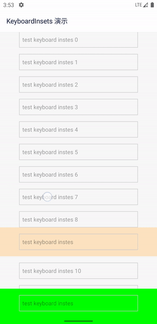
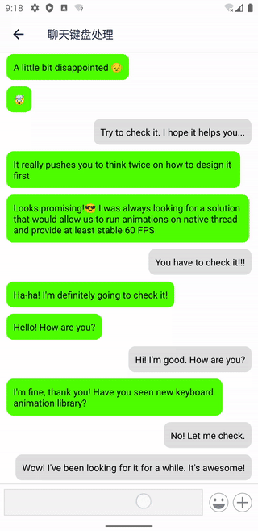

# @ftsukic/rnoh-keyboard-insets

`KeyboardInsetsView` 是一个 React Native 原生 UI 组件，用于处理软键盘遮挡输入框的问题。

`KeyboardInsetsView` 使用简单，自动模式下不需要额外代码来处理键盘。

|                                                                                                                                                 |                                                                                                                                             |
| ----------------------------------------------------------------------------------------------------------------------------------------------- | ------------------------------------------------------------------------------------------------------------------------------------------- |
|  |  |

本库主要依据 Android 官方指南 [Synchronize animation with the software keyboard](https://developer.android.com/develop/ui/views/layout/sw-keyboard#synchronize-animation) 来实现，同时参考了 [react-native-keyboard-controller](https://github.com/kirillzyusko/react-native-keyboard-controller)。因为该库不是很符合我的需求，所以我自己写了一个。

## 版本兼容

| 包版本 | React Native | RNOH | 架构 |
| ------ | ------------ | ---- | ---- |
| 0.1.x  | 0.82.1       | 0.82.33 | C-API |

## Installation

```bash
yarn add @ftsukic/rnoh-keyboard-insets
```

### iOS

```sh
cd ios
pod install
```

### Android

开启 [edge-to-edge](https://developer.android.com/develop/ui/views/layout/edge-to-edge)。 这将使得 APP 的 UI 撑满整个屏幕，而不是被系统 UI（譬如虚拟导航键）遮挡，从而实现更摩登的 UI 效果。

```java
// MainActivity.java
import androidx.core.view.WindowCompat;

public class MainActivity extends ReactActivity {
    @Override
    protected void onCreate(Bundle savedInstanceState) {
        super.onCreate(null);
        // enable Edge-to-Edge
        WindowCompat.setDecorFitsSystemWindows(getWindow(), false);
    }
}
```

为了更好的向后（Android 10 以前）兼容, 在 AndroidManifest 中设置 `android:windowSoftInputMode="adjustResize"`。

```xml
<!-- AndroidManifest.xml -->
<activity
  android:name=".MainActivity"
    ...
  android:windowSoftInputMode="adjustResize">
  <intent-filter>
    ...
  </intent-filter>
</activity>
```

开启 Edge-to-Edge 后，你的 UI 会撑满整个屏幕，可使用 [react-native-safe-area-context](https://github.com/th3rdwave/react-native-safe-area-context) 来处理和系统 UI (譬如虚拟导航键) 重叠的部分。

可参考以下代码进行全局处理，也可以每个页面单独处理，以实现更美观更摩登的 UI 效果。

```tsx
import { Platform } from 'react-native';
import { SafeAreaProvider, SafeAreaView } from 'react-native-safe-area-context';

function App() {
  return (
    <SafeAreaProvider>
      <NavigationContainer>...</NavigationContainer>
      {Platform.OS === 'android' && <SafeAreaView mode="margin" edges={['bottom']} />}
    </SafeAreaProvider>
  );
}
```

> 如果使用 [hybrid-navigation](https://github.com/listenzz/hybrid-navigation) 作为导航组件，则不需要做任何事情，因为它已经帮你处理好了。

### HarmonyOS / RNOH

RNOH 三方库需要在 Harmony 工程里链接原生包。以下步骤使用源码链接，避免依赖随仓库提交的预编译 HAR。

1. 在 `harmony/entry/oh-package.json5` 的 `dependencies` 中加入：

   ```json5
   "@rnoh/react-native-keyboard-insets": "file:../../node_modules/@ftsukic/rnoh-keyboard-insets/harmony/keyboard_insets"
   ```

   保留应用已有的 `@rnoh/react-native-openharmony` 依赖和 `overrides`，然后运行 `ohpm install --all`。

2. 在 `harmony/entry/src/main/cpp/CMakeLists.txt` 添加源码目录和链接目标：

   ```cmake
   set(OH_MODULES "${CMAKE_CURRENT_SOURCE_DIR}/../../../oh_modules")
   add_subdirectory(
       "${OH_MODULES}/@rnoh/react-native-keyboard-insets/src/main/cpp"
       ./rnoh_keyboard_insets)
   target_link_libraries(rnoh_app PUBLIC rnoh__keyboard_insets)
   ```

3. 在 `PackageProvider.cpp` 注册 C++ 包：

   ```cpp
   #include "ReactNativeKeyboardInsetsPackage.h"

   // PackageProvider::getPackages(ctx) 返回的包列表中加入：
   std::make_shared<rnoh::ReactNativeKeyboardInsetsPackage>(ctx)
   ```

4. 在 `RNOHPackagesFactory.ets` 注册 ArkTS 包：

   ```ts
   import KeyboardInsetsPackage from '@rnoh/react-native-keyboard-insets';

   // createRNOHPackages(ctx) 返回的包列表中加入：
   new KeyboardInsetsPackage(ctx)
   ```

RNOH 默认会通过窗口避让键盘。处于 `KeyboardAvoidMode.OFFSET` 或 `RESIZE` 时，本组件沿用系统避让，避免重复移动；设置为 `KeyboardAvoidMode.NONE` 时，本组件会按焦点输入框位置单独移动容器。此模式是窗口级设置，库不会替应用修改。

## Usage

使用 `KeyboardInsetsView` 代替 `View` 作为容器，或者使用 `KeyboardInsetsView` 将 `ScrollView` 包裹起来。当键盘显示或隐藏时，`KeyboardInsetsView` 会自动调整自身的位置，以保证输入框不被键盘遮挡。

```tsx
import { KeyboardInsetsView } from '@ftsukic/rnoh-keyboard-insets';

function MyComponent() {
  return (
    <KeyboardInsetsView extraHeight={16} style={{ flex: 1 }}>
      <ScrollView>
        ...
        <TextInput />
        ...
      </ScrollView>
    </KeyboardInsetsView>
  );
}
```

Support Nested.

```tsx
import { KeyboardInsetsView } from '@ftsukic/rnoh-keyboard-insets';

function MyComponent() {
  return (
    <KeyboardInsetsView extraHeight={16} style={{ flex: 1 }}>
      ...
      <KeyboardInsetsView extraHeight={8}>
        <TextInput />
      </KeyboardInsetsView>
      ...
    </KeyboardInsetsView>
  );
}
```

`KeyboardInsetsView` 本质上是个 `View`，所以你可以使用 `View` 的所有属性，也可以和 `View` 互相替换。

`KeyboardInsetsView` 仅有少量几个属性：

- `extraHeight`：自动模式下，键盘总是紧贴着输入框的下边缘，这个属性设置输入框距离键盘的额外高度。<u>KeyboardInsetsView 的最大偏移受键盘高度限制，若加入额外高度后，KeyboardInsetsView 偏移距离大于键盘高度，将产生截断，此时 KeyboardInsetsView 偏移距离等于键盘高度，底部将与键盘顶部相贴</u>

- `explicitly`：仅对 iOS 生效，自动模式下，是否显式地跟随键盘位置变化。默认为 `false`，通过隐式动画来处理。

- `onKeyboard`：是个回调函数，一旦设置，就进入手动模式，`KeyboardInsetsView` 不会帮你调整输入框的位置。你需要利用这个回调函数实现自己想要的效果。

  `onKeyboard` 的参数声明如下：

  ```tsx
  interface KeyboardState {
    height: number; // 键盘的高度，不会因为键盘隐藏而变为 0
    shown: boolean; // 当键盘将隐已隐时，这个值为 false；当键盘将显已显时，这个值为 true
    transitioning: boolean; // 键盘是否正在显示或隐藏
    position: Animated.Value; // 键盘的位置，从 0 到 height，可以用来实现动画效果
  }
  ```

## API

- `useKeyboard`

  为了方便用户编写 `onKeyboard` 回调，keyboard-insets 提供了一个 `useKeyboard` hook，使用方法如下：

  ```tsx
  import { useKeyboard } from '@ftsukic/rnoh-keyboard-insets'

  function MyComponent() {
    const { keyboard, onKeyboard } = useKeyboard()

    console.log(keyboard.height), // 键盘的高度

    return (
      <KeyboardInsetsView onKeyboard={onKeyboard}>
        <TextInput />
      </KeyboardInsetsView>
    )
  }
  ```

## Caution

如果你在项目中同时使用了[react-native-bars](https://github.com/zoontek/react-native-bars)，那么在初始化它的时候，需要把它内置的键盘处理逻辑关闭：

```java
// in MainActivity.java

  @Override
  protected void onCreate(Bundle savedInstanceState) {
    // ...other code
    super.onCreate(savedInstanceState);
    RNBars.init(this, "dark-content", false); // <- 第三个参数必须要设置为false
    // ...other code
  }
```
